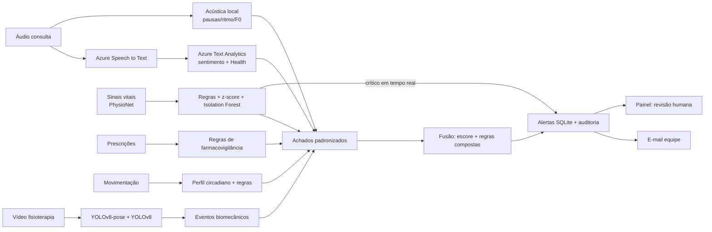

# Tech Challenge Fase 4 — Monitoramento multimodal de pacientes

Projeto individual de Gabriel Augusto Russo, continuação das fases
[1](https://github.com/gabrielrusso6/tech-challenge-fase1-diagnostico-cancer-mama),
[2](https://github.com/gabrielrusso6/tech-challenge-fase2-otimizacao-diagnostico) e
[3](https://github.com/gabrielrusso6/tech-challenge-fase3-assistente-medico).

**Cenário:** paciente fictícia (SYN-101) internada após mastectomia (continuidade do tema
câncer de mama). O sistema monitora sinais vitais, prescrições, movimentação, sessões de
fisioterapia em vídeo e consultas em áudio, funde os achados e alerta a equipe médica, que
precisa revisar cada alerta.

> Protótipo acadêmico. Dados públicos (PhysioNet), sintéticos ou gerados por TTS. Não é
> dispositivo médico e não substitui avaliação clínica.

## O que cada requisito usa

| Requisito | Implementação | Módulo |
|---|---|---|
| Análise de vídeo | YOLOv8-pose (17 keypoints, mesmo conceito do OpenPose) + YOLOv8 (objetos), ângulos articulares, repetições, regras biomecânicas, Isolation Forest, relatório automático e vídeo anotado | `src/tc4/video/` |
| Análise de áudio | **Azure Speech to Text** (transcrição com timestamps), **Azure AI Language / Text Analytics** (sentimento com opinion mining, frases-chave, Text Analytics for Health), léxico de termos críticos e indicadores vocais (pausas, ritmo, monotonia, energia) | `src/tc4/audio/` |
| Anomalias — sinais vitais | PhysioNet BIDMC (FC, FR, SpO2) + PA sintética; regras clínicas com persistência, z-score robusto causal, Isolation Forest; avaliação com anomalias injetadas e rotuladas; monitor incremental em tempo real | `src/tc4/anomaly/vitals.py` |
| Anomalias — prescrições | Dose acima do máximo, alteração abrupta, duplicidade de classe, interações, suspensão de uso contínuo, instabilidade | `src/tc4/anomaly/prescriptions.py` |
| Anomalias — movimentação | Imobilidade prolongada, agitação noturna, possível queda, declínio funcional | `src/tc4/anomaly/movement.py` |
| Fusão e alertas | Escore de risco 0–100, regras compostas entre modalidades, SQLite com auditoria, e-mail SMTP (ou `.eml` local), revisão humana no painel | `src/tc4/fusion/`, `src/tc4/alerts/` |
| Interface | Painel Streamlit: central de alertas, monitor em tempo real, vídeo, áudio | `app/dashboard.py` |

## Fluxo multimodal



## Instalação (macOS Apple Silicon ou Windows, Python 3.11/3.12)

```bash
python3 -m venv .venv
source .venv/bin/activate            # Windows: .venv\Scripts\Activate.ps1
python -m pip install --upgrade pip
python -m pip install -r requirements.txt
python -m pip install -e . --no-deps
python -m pytest -v                  # testes não precisam de Azure nem YOLO
```

Na primeira análise de vídeo o `ultralytics` baixa `yolov8n-pose.pt` e `yolov8n.pt`
(~10 MB) automaticamente.

## Configuração do Azure

Siga [docs/AZURE_SETUP.md](docs/AZURE_SETUP.md), copie `.env.example` para `.env`, preencha as
chaves e valide:

```bash
tc4 azure-check
```

## Execução passo a passo

```bash
# 1. Sinais vitais: baixa 10 registros do PhysioNet e mede os detectores
tc4 download-physionet --records 1-10
tc4 vitals-eval --records 1-10        # reports/vitals_evaluation_*.csv e figures/

# 2. Áudio: gera consultas sintéticas pt-BR (Azure TTS) e analisa
python scripts/generate_consultation_audio.py
tc4 audio --input data/samples/consulta_alerta.wav
tc4 audio --input data/samples/consulta_estavel.wav --patient SYN-102

# 3. Vídeo: coloque um vídeo público em data/samples/ (ver data/samples/README.md)
tc4 video --input data/samples/fisioterapia.mp4 --max-seconds 60

# 4. Prescrições e movimentação
tc4 prescriptions --patient SYN-101
tc4 movement --patient SYN-101

# 5. Fusão e alertas (e-mail ou runtime/outbox/*.eml)
tc4 fuse --patient SYN-101
tc4 alerts list
tc4 alerts review --id 1 --reviewer "Dra. Exemplo" --decision reconhecido

# Tudo de uma vez
tc4 demo --patient SYN-101 --record 1 --video data/samples/fisioterapia.mp4 \
         --audio data/samples/consulta_alerta.wav
```

Painel:

```bash
streamlit run app/dashboard.py
```

Resultados de cada execução ficam em `runtime/results/<paciente>/<módulo>/` (relatórios
Markdown/JSON, gráficos, vídeo anotado). Logs em `runtime/logs/tc4.log`.

## Dados

| Dado | Origem | Observação |
|---|---|---|
| Sinais vitais | [PhysioNet BIDMC](https://physionet.org/content/bidmc/1.0.0/) (ODC-By 1.0) | FC, FR e SpO2 reais a 1 Hz; PA **sintética** (o BIDMC não tem PA); anomalias injetadas e rotuladas para avaliação |
| Prescrições | `data/prescriptions/prescriptions_demo.csv` | Sintético; tabela de referência educacional |
| Movimentação | Gerador sintético com eventos rotulados | Não há dataset público equivalente com internação e quedas anotadas |
| Vídeo | Vídeos públicos com licença livre (Pexels/Mixkit) | Não versionados; atribuição no relatório |
| Áudio | Azure TTS (consulta sintética pt-BR) e clipes públicos | Marcadores vocais simulados via SSML |

## Limitações

- OpenPose foi substituído por YOLOv8-pose (mesma tarefa de estimativa de pose; instalação
  viável em macOS/Windows). O enunciado cita OpenPose como exemplo.
- COCO não tem instrumentos cirúrgicos: análise de cirurgia exigiria detector treinado em
  dataset próprio (ex.: m2cai16-tool, Cholec80).
- Indicadores vocais são heurísticos, sem diarização (voz do médico entra na análise) e sem
  validação clínica. Limiares documentados em `src/tc4/audio/acoustic.py`.
- Limites de sinais vitais e doses são educacionais; não substituem protocolos.
- Sem autenticação real: o nome do revisor é rótulo de demonstração.
